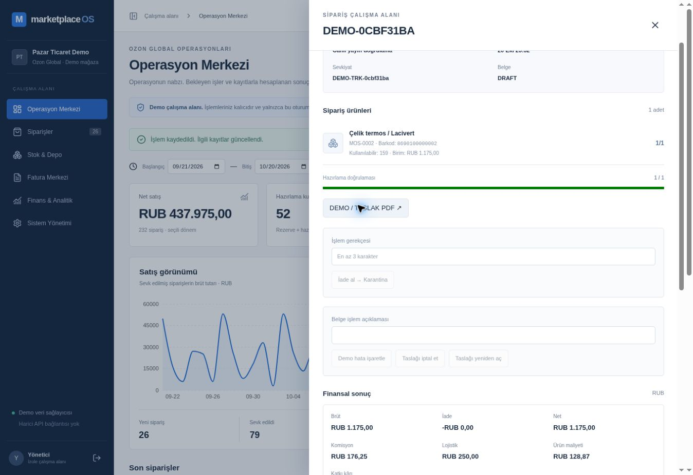

# Doğrulama raporu

## 21 Ekim 2026 — INV-02 iade masası

`npx vitest run tests/returns.test.ts tests/navigation.test.ts`: **6/6 PASS**, 596ms. 4 saf iade testi: FBS/status/orphan/sıralama ve immutability; SKU/barkod/Türkçe/gerekçe araması; order referansı bazlı karantina ve kayıp ürün/durum engeli; bekleme saati. 2 navigasyon testi: mevcut URL allowlist ve yeni returns bölümünde depo erişimi/muhasebe güvenli varsayılanı. Typecheck/lint (0 uyarı)/format/production build PASS. QC sunucu mutasyonu/DB migration değişmedi; geniş DB/E2E ve yeni browser kabul/ret işlemi bu görevde koşulmadı. Yayın ve salt okuma canlı kontrol ayrıca kaydedilir.

---

## 21 Ekim 2026 — CAT-01

`CATALOG_DB_TEST=1 npx vitest run tests/catalog.test.ts tests/catalog.db.test.ts`: **9/9 PASS**, 81.05s. 2 saf: doğrulama/stock-source enjeksiyon reddi, altı kaynak manifest sınırı. 7 gerçek PostgreSQL: sıfır stok/tekrar güvenli create, SKU-barkod ve workspace tekilliği, düzenleme/sürüm/başka alan reddi, tarihsel fiyat-maliyet ve pasif ürünün eski sipariş sevki, depo yetkisi/legacy sürüm artışı, import idempotency + rezervasyon-barkod-sevkiyat-finans, yeni seed/reset generation. 0003 migration önce izole `br-royal-fog-bael0zdv` dalında uygulandı; test iki UUID alanını oluşturup temizledi. Typecheck/lint (0 uyarı)/format/build PASS. Kapsamlı eski domain/E2E çalıştırılmadı; seed sayısı beklentileri güncellendi. Canlı migration/yayın ayrıca kaydedilir.

---

## 21 Ekim 2026 — FX-01 gösterim karşılığı

`npx vitest run tests/exchange-rates.test.ts`: **5/5 PASS** (son koşu 300ms toplam, 29ms test). Kur birimi normalizasyonu; kaynak/tarih meta; RUB/TRY/EUR çapraz dönüşüm; pozitif/negatif yarım yuvarlama; tamsayı sınırı; eksik/bozuk/DTD/tekrarlı/ileri/eski bülten reddi; sabit kaynak fetch ve HTTP/HTML başarısızlığı. Gerçek HTTP 200 TCMB XML gövdesi parserdan geçti (bülten 20.10.2026). Önceki kapsamlı domain/DB/E2E paketi bu görevde tekrarlanmadı; kur testleri gerçek satış veya muhasebe kabulü değildir. Build ilk denemede eski Turbopack persistence dizininden hata verdi; üretilmiş .next kenara taşınıp temiz build geçti. Son kaynak için typecheck/lint (0 uyarı)/format/production build PASS. Yayın/canlı gözlem ayrıca kaydedilecek.

---

## 21 Ekim 2026 — OPS-02 kayıtlı görünümler

Canlı ek kayıt: `1b5c1aa` kodu production READY. Kişisel görünüm kaydet → tam yenile → filtre/sıralama geri yükleme gözlendi. 20 seçimin toplu aday sayıları kontrol edildi; sevkiyat gönderilmedi. [Kanıt ve kapsam sınırı](research/OPS02_SMOKE.md).

TypeScript, lint (0 uyarı), format ve production build PASS. `/api/order-views` route'u build edildi. `ORDER_VIEWS_DB_TEST=1 npx vitest run tests/order-views.test.ts tests/order-views.db.test.ts`: **8/8 PASS**, 19.02s. 4 saf test: tarih/sütun doğrulama, Türkçe isim tekilliği/silme, birleşik SKU/barkod/Türkiye günü filtresi, FBO/hazırlama uygunluğu. 4 gerçek PostgreSQL testi: workspace/kullanıcı izolasyonu ve shared snapshot redaksiyonu; mağaza ayarında view/sentinel korunması; aynı revision'da eşzamanlı yazmalardan birinin 409 olması; eski generation/pasif kullanıcı reddi. Testler ayrı Neon `dev-ops02-validation` dalında çalıştı, yalnız kendi iki UUID workspace'ini oluşturup temizledi. Canlı veritabanında test/reset/migration yok. Önceki tam domain/E2E paketi bu dilimde tekrarlanmadı; [yeni kabul listesi](planning/TEST_HANDOFF.md) açık. Uzak Actions başarısı ayrıca doğrulanmalıdır.

---

## 21 Ekim 2026 — UI-01 giriş / çalışma ayrımı

Canlı ek kayıt: `a11f607` kodu Vercel production'da READY. Mevcut yönetici oturumunda merkeze/çalışma ekranına geçiş ve Hazırlama Masası'na dönüş seçimi gözlendi. [Smoke kapsamı ve görüntü](research/UI01_SMOKE.md); yeni oturum/rol değişimi ve tam E2E bu kapsamda değil.

TypeScript, lint (sıfır uyarı), biçim kontrolü ve production build PASS. `npx vitest run tests/navigation.test.ts`: **2/2 PASS**; role uygun başlangıç, yasak bölüm ve allowlist dışı URL/nesne/prototype değerlerinde güvenli varsayılan. `/` Demo Merkezi ve `/workspace` session kontrollü çalışma rotası build edildi. Session/stock/finans yazma kuralları değiştirilmedi; `currentActor` mevcut resolver'ın salt okuma paylaşımıdır. DB entegrasyon/E2E bu turda çalıştırılmadı. Önceki E2E helper'ı yeni rol seçimine uyarlandı; test kaynak güncellemesi başarılı test koşusu anlamına gelmez. Kullanıcı kontrolü ve kapsamlı regresyon [test devir listesinde](planning/TEST_HANDOFF.md) bekliyor.

---

## 21 Ekim 2026 — OPS-01 ek kontrolü

Hazırlama masası ve repo planlama kayıtları eklendi. Typecheck, lint, format kontrolü ve production build PASS. `npx vitest run tests/packing.test.ts`: **3/3 PASS**, FBS/durum uygunluğu, sıra, rezervasyon/stok engeli, kuyruk ayrımı ve arama. Yeni UI için browser/DB E2E ve fiziksel scanner testi bu turda çalıştırılmadı. Sonraki Codex/kullanıcı kabul listesi: [TEST_HANDOFF.md](planning/TEST_HANDOFF.md). Bu sonuçlar aşağıdaki önceki çalışma sonuçlarını güncel sürümde tekrar doğrulamaz. Vercel yeni commit için ayrı izlenmelidir.

---

Tarih: 20 Ekim 2026, Europe/Istanbul. Yalnız kurgusal demo verisi kullanıldı.

## Yerel sonuçlar

| Kontrol                | Sonuç                                      | Kanıt                                                             |
| ---------------------- | ------------------------------------------ | ----------------------------------------------------------------- |
| TypeScript             | Başarılı                                   | `npm run typecheck`                                               |
| ESLint                 | Başarılı, sıfır uyarı                      | `npm run lint`                                                    |
| Biçim                  | Başarılı                                   | `npm run format:check`                                            |
| Production build       | Başarılı                                   | Next.js 16.4.2, App Router, Node 24                               |
| PostgreSQL entegrasyon | 15/15 başarılı                             | Gerçek Neon PostgreSQL 18, iki izole test workspace'i             |
| HTTP regresyon         | 2/2 başarılı                               | Origin/Host kontrolü ve sahte forwarded host reddi                |
| Finans birim testleri  | 2/2 başarılı                               | Tam kuruş gider tahsisi, ürün maliyeti ve toplam katkı mutabakatı |
| Playwright E2E         | 2/2 başarılı (son revizyon: 57.2s + 21.7s) | Headless Chromium, production Next.js sunucusu                    |

Veritabanı paketinin son başarılı çalışması 143.21 saniye sürdü. Toplam 19 domain/HTTP/finans testi ayrı test koşularında doğrulandı. İlk bulunan foreign key temizlik sırası hatası deferred FK migration ile giderildi; testler ve cleanup tekrar geçti. Kısıtlı ortamda tarayıcı dağıtımı npm Chromium paketiyle sağlandı; web güvenliği kapatan ve çoklu context'i bozan Chromium bayrakları kaldırıldı.

## Kapsanan senaryolar

1. Rezervasyon fiziksel stoğu değiştirmez, tekrar rezervasyon miktarı büyütmez.
2. Sevkiyat bir stok çıkışı, bir sevkiyat ve tekil finans hareketleri oluşturur.
3. İptal rezervasyonu çözer; sevk edilmemiş sipariş için sahte fiziksel stok girişi oluşmaz.
4. Yetersiz stok rezervasyonu rollback eder; rezervasyonsuz hazırlama engellenir.
5. İki eşzamanlı sipariş aynı stoğu aşamaz.
6. Aynı idempotency anahtarlı barkod okutma ikinci adet yazmaz; farklı payload aynı anahtarla reddedilir.
7. Karantina iadesi QC öncesinde satılabilir stoğu artırmaz; tekrarlanan QC ikinci stok girişi üretmez.
8. Reddedilen QC satılabilir stoğu artırmaz, ürün maliyet kaybını korur.
9. Fatura unique DEMO / TASLAK kaydıdır; gerçek e-Fatura gönderimi kapalıdır.
10. Brüt satış finans defteri ile sevk edilen temel sipariş tutarlarının toplamına eşittir; bilinmeyen maliyette katkı NULL'dır.
11. Rol kontrolü sunucuda işler; depo rolü maliyet/finans ve yönetim audit içeriğini alamaz.
12. Farklı workspace'in siparişi hedeflenemez, stokları etkilenmez.
13. FBO siparişinde yerel FBS işlemine izin verilmez.
14. Reset yalnız kendi alanını değiştirir, yeni generation üretir ve eski sekmenin işlemini reddeder.
15. Ürün katkısında her ürünün gerçek maliyet fotoğrafı kullanılır; gider tahsisi toplam kuruş/kopeği korur.

## Tarayıcı kanıtı

- İki ürünlü sipariş, iki adet aynı barkod ve bir adet ikinci barkod ile doğrulandı.
- Rezervasyon → sevkiyat → taslak belge açma → finans görünümü → Excel indirme → geçerli PDF yanıtı → karantina iade → QC onayı zinciri geçti.
- 1440×900 ve 1920×1080 ekran görüntüleri üretildi ve incelendi. 390px görünümde sayfa yatay taşması kontrol edildi. Gerçek fiziksel cihaz testi yapılmadı.
- Depo rolü finans menüsünü görmez ve rapor HTTP isteği 403 alır.
- İki ayrı browser context farklı workspace alır; ikinci alan sıfırlanınca ilk alanın generation/sipariş sayısı korunur.

## Yayın doğrulaması

- GitHub: `main` dalına araştırma/çekirdek, altı modüllü uygulama ve rapor/erişim düzeltmesi anlamlı ayrı commit'lerle aktarıldı.
- Yayındaki uygulama commit'i: `facdcb52da6b0345d77fe0cf62732152f57419ea`.
- Vercel production: **READY**, deployment `dpl_GUtLgrZyMgHCnzApW2bigCwypx8B`; fonksiyon bölgesi `fra1`, Node 24, Next.js 16.4.2.
- Canlı adres: https://marketplace-os-amber.vercel.app/
- Canlı tarayıcıda izole alan açıldı; `DEMO-0CBF31BA` siparişi oluşturuldu → rezerve edildi → `8690100000002` barkodu doğrulandı → sevk edildi → DEMO fatura taslağı oluşturuldu.
- Kaynak sonuç: 1.175,00 RUB satış − 176,25 RUB komisyon − 250,00 RUB lojistik − 128,87 RUB ürün maliyeti = **619,88 RUB katkı**. Ana depo çıkışı −1 adet ve tek sevkiyat referansı detayda görüldü.
- Son deployment sonrasında sayfa yenilendi; aynı workspace ve oluşturulan sipariş/fatura korundu.
- Son deployment için error/fatal runtime log sorgusunda kayıt bulunmadı. Harici monitoring/alerting veya log drain kurulmadı; uzun dönem gözlemlenebilirlik iddia edilmez.
- GitHub Actions **başarısız / doğrulanamadı**: ilk run `39492346366`, verify job `118868507625`, adımlar boş. Günlük isteği **404 BlobNotFound**. Kök neden loglardan kanıtlanamadı; uzak CI başarılı olarak raporlanmaz. Yerel doğrulamalar ve Vercel build sonucu bundan ayrıdır.
- İlk başarısız fixture temizlik adımından kalan iki test workspace'i, oluşturulma zamanı ve UUID'leri doğrulanarak yalnız bu iki kaydı hedefleyen işlemle temizlendi.

## Üretim sınırları

FBS yerel demo akışı doğrulanmıştır. Gerçek Ozon/Paraşüt, FBO operasyonu, elektronik belge/vergi uygunluğu, kargo taşıyıcısı takibi, üretim kullanıcı kimliği ve gerçek cihaz testi yapılmış değildir. Detaylar ARCHITECTURE.md ve REVERSE_ENGINEERING.md içindedir.

FX-01 canlı ek kayıt: `edb55b6` production READY. Siparişler ekranında TCMB tarih/kaynak ve özgün RUB tutar altında TL → EUR → kapalı → TL geçişi doğrulandı; sipariş/stok/finans mutasyonu yapılmadı. [Kapsam ve ekran](research/FX01_SMOKE.md). Kullanıcı kabulü bekliyor.

CAT-01 migration ek kaydı: İzole dalda test edildikten sonra `0003_catalog.sql` canlı demo `marketplace` DB / `br-still-grass-bab2y1vf` üzerinde uygulandı. active=true, catalog_version=0, source={} varsayılanları schema sorgusuyla doğrulandı. Eski ürün/stock/order tutarları güncellenmedi; paket mevcut alanlara ayrıca UI üzerinden eklenecek.

CAT-01 yayın ek kaydı: `afc8b4f` kodu production READY. Mevcut yönetici alanında UI ile paket eklendi, 72→78 ürün ve +72 referanslı demo stok gözlendi; filtre/kaynak, kimlik kilidi ve yeni SKU formu açılması kontrol edildi. Canlı sevkiyat/reset/manual SKU kaydetme yapılmadı. [Kapsam ve ekran](research/CAT01_SMOKE.md). Kullanıcı kabulü bekliyor.

INV-02 yayın ek kaydı: `545b690` production READY. Yönetici oturumunda durum kuyrukları, barkod arama/sayıları, referanslı karantina ayrımı, gerekçe+checkbox düğme kilidi ve tamamlanmış iadenin read-only hâli gözlendi. QC gönderilmedi; canlı kayıt değişmedi. [Kapsam ve görüntü](research/INV02_SMOKE.md). Kullanıcı kabulü bekliyor.

ARCH-01 — 21 Ekim 2026: execute komut kapısı korunarak sipariş/stok/iade/fatura/finans/sistem servisleri ayrıldı. İzole `dev-ops02-validation` dalında domain + katalog PostgreSQL regresyonu **23/23 PASS**, toplam **342.32s**. Yeni geç aşama finans hatası senaryosu stok/rezervasyon/sevkiyat/finans/fatura/receipt/audit rollback ve aynı anahtarla düzeltme sonrası tek sevkiyatı doğrular. Typecheck/lint (0 uyarı)/format/build PASS. Test workspace'leri temizlendi; canlı DB'de test/reset/migration yapılmadı. Kapsamlı tarayıcı E2E ve uzak CI bu sonuç kapsamında değildir.

## INV-01 / INT-01 / FIN-01 / DOC-01 — 21 Ekim işlevsel tamamlama

Ortam: Node 24.19.0; Neon PostgreSQL 18, yalnız izole dev-ops02-validation (br-royal-fog-bael0zdv). Yeni migration 0004–0007 bu dalda uygulandı; canlı DB ve canlı sürüm değiştirilmedi. Yeni testler UUID workspace'lerinde çalışır ve kendi kayıtlarını temizler.

- `npm run typecheck`, `npm run lint`, `npm run format:check`, `npm run build`: PASS, lint 0 uyarı. Yeni stok/fatura/maliyet bileşenleri React kontrol listesiyle kod üzerinden gözden geçirildi; tarayıcı kabulü sayılmaz.
- inventory-documents.db.test.ts son hedefli koşu: 7/7 PASS, 281.22s toplam. İlk koşudaki cascade FK temizleme hatası düzeltilip tekrar migrate edildi; eski başarısız koşu PASS diye sayılmadı.
- finance + reporting-periods + integrations saf paket: 8/8 PASS, 7.28s. Dönem ayrımı, reversal-only ürün mutabakatı, özgün maliyet fotoğrafı ve değiştirilebilir demo portu.
- operations-completion.db.test.ts: 6/6 PASS, 112.405s test. Sağlayıcı çağrısı/tekil fatura/geçmiş, sağlayıcı hatasında atomik rollback, sahte dış gönderim reddi, maliyet idempotency/yetki/redaksiyon, kabul edilmiş iade sonrası maliyetin ters kaydı, kısmi maliyet tamamlama, yeni tabloların workspace reset/izolasyonu.
- Mevcut domain.test.ts: 16/16 PASS, 290.158s test. Stok, rezervasyon, sevkiyat, iptal/iade/QC, yarış, yetki, izolasyon ve eski nesil/reset korunur.

Toplu koşu komutu: `CATALOG_DB_TEST=1 ORDER_VIEWS_DB_TEST=1 INVENTORY_DB_TEST=1 OPERATIONS_DB_TEST=1 node --env-file=.env.local node_modules/vitest/vitest.mjs run --testTimeout=120000 --hookTimeout=120000`. Toplu sonuç: **15 dosya / 70 test PASS**, 644.96s toplam (612.26s test). Bayraklı dört ek DB dosyası da çalıştı; atlanan test yok. Kaynak başlangıcı 12880fd; bu raporla aynı teslim commitindeki uygulama kaynakları kontrol edildi. Bu zaman sınırı yalnız uzak test ortamı komutundadır; uygulama timeout'u değiştirilmedi.

Gmail salt okunur gözleminde Quality başarısızlık mailleri doğrulandı. Son uzak run 39575718102 adım çalıştırmamış, log 404; kök neden bilinmiyor. Workflow YAML parse edilerek yalnız workflow_dispatch ve bütün kalite/yeni DB adımları korunduğu kontrol edildi. Uzak CI PASS denmez; tekrar run veya e-posta üreten otomasyon başlatılmadı.

Kapsam dışı/henüz doğrulanmayan: yeni tarayıcı E2E, gerçek scanner, bütünleşik tasarım ve kullanıcının manuel kabulü, Excel/PDF dosyasının elle açılıp gözden geçirilmesi, Vercel READY/yeni canlı smoke. Yeni kod GitHub'da saklansa da yayında değildir.

## 21 Ekim 2026 — Public depo / ilk izole teknik kabul

- Kaynak commit `3b975ee`; public GitHub klonu Vercel Sandbox'ta, Node 24.22.1 ile `npm ci` PASS.
- İlk `npm run typecheck` iki nullable rehber index hatasıyla, `npm run lint` Ozon bağlantısının JSX apostrof hatasıyla, `npm run format:check` 11 dosyanın biçimi nedeniyle FAIL. Düzeltilmiş kaynakta **typecheck / lint / format:check PASS**.
- `npm run build` **PASS** (Next.js 16.4.2).
- Canlıdan izole Neon kabul dalı: `acceptance-marketplace-20261021` (güncel geliştirme dalından kopyalandı). `npm run db:migrate` **PASS**, migration `0001`–`0007` çalıştı. Canlı `main` DB'sine migration veya reset yapılmadı.
- İzole dalın `DATABASE_URL` bağlantısıyla `npm test`: **56 PASS**, **24 SKIP** (dört flag-gated DB suite). İlk DB'siz koşuda `DATABASE_URL yapılandırılmamış` hatası vardı; izole DB ile tekrar koşu PASS.
- Playwright E2E ve 24 hedefli DB senaryosu **halen beklemede**. Bunlar geçmeden bütün ürün doğrulanmış sayılmaz. Vercel production güncellenmedi; kullanıcı kabulü bekliyor.

### 21 Ekim 2026 — Tam izole QA kapısı / kullanıcı kabul bağlantısı

- Uygulama kaynak ağacı: `eb9ae025` (rehber TypeScript, Ozon JSX, Prettier düzeltmeleri). Node.js 24.22.1 üzerinde typecheck **PASS**, ESLint **PASS**, Prettier **PASS**, Next.js production build **PASS**.
- Vercel Sandbox içindeki **bağımsız PostgreSQL 18** sunucusunda boş `marketplace_acceptance` veritabanı oluşturuldu. `0001`–`0007` migration **PASS**. Bu localhost test DB'si production DB değildir.
- Tüm DB test bayrakları açıkken `npm test`: **18 test dosyası, 80/80 PASS, 0 SKIP**. Sipariş, stok, rezervasyon, sevkiyat, belge, maliyet tamamlama, QC, roller, izolasyon ve yeni Ozon manifest kontrolleri dahil.
- Playwright başlangıç denemelerinde bundled Chromium önce eksik `libnspr4.so`/`libnss3.so`, sonra tarayıcı kapanmasıyla test başlatamadı; eksik çalışma ortamı giderildi ve Playwright'ın kendi Chromium sürümü kuruldu. **Son gerçek Chromium tarayıcı koşusu 6/6 PASS** (ilk giriş rehberi, workspace turu, 390px mobil rehber, Ozon fiyat/kaynak paneli, FBS sipariş→rezervasyon→barkod→sevk→fatura→finans→rapor→iade/QC, rol izolasyonu/sıfırlama). E2E 17.9 saniyede tamamlandı.
- Kullanıcı kabulü için **geçici Vercel Sandbox** bağlantısı: `https://sb-4kislw650242.vercel.run/`. Ayrı PostgreSQL 18 localhost ile çalışır, GET `/` HTTP 200 gözlendi. **Sandbox oturumu en fazla 30 dakika sürer, bu link kalıcı Vercel deployment değildir.** Oturum kapanırsa yeni/resume session gerekir. Buradaki URL'nin geçici doğası kullanıcıya özellikle belirtilir.
- Vercel production projesi `d0f13f0` üzerinde korunur; yeni production deployment veya ana Neon şemasında değişiklik bu QA kapsamında yapılmadı. Son kullanıcı kabulü henüz **BEKLİYOR**.
