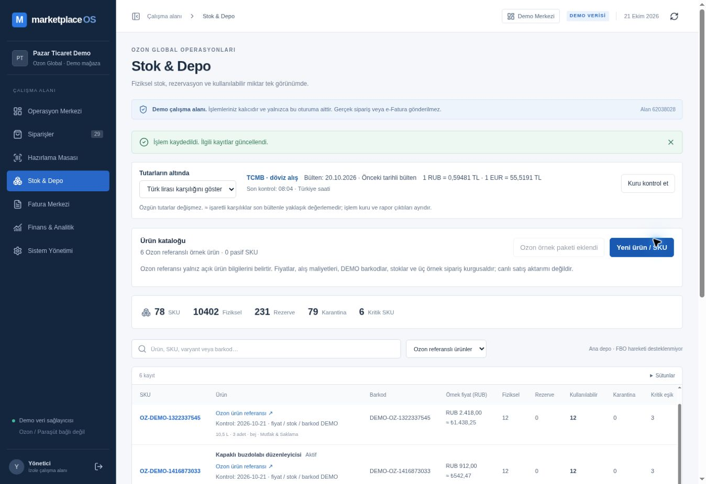

# CAT-01 — Canlı kontrol

21 Ekim 2026. Kod commit `afc8b4f276f4832b47cecb51f29641c5f5b81823`. Vercel deployment `dpl_4spfQ87FLsD5Ux5sdET8FnQBwhsd` production READY; commit ve marketplace-os-amber.vercel.app alias eşleşmesi kontrol edildi. 0003 additive migration önce izole dalda 9 testle doğrulandı, sonra canlı demo DB'ye uygulandı.

Adres: https://marketplace-os-amber.vercel.app/workspace?section=inventory

Mevcut yönetici demo alanında Stok & Depo açıldı. Ozon örnek paketi bir kez UI düğmesiyle eklendi: ürün sayısı 72→78, fiziksel toplam 10330→10402; kaynaklı ürün sayısı 6 ve paket düğmesi devre dışı oldu. Ozon referanslı ürünler filtresi altı kartı gösterdi; kaynak bağlantısı, kontrol tarihi ve fiyat/stok/barkod DEMO ifadesi gözlendi. Paket üç NEW FBS sipariş de aynı transaction'da oluşturur; canlıda bu siparişler rezerve/sevk edilmedi. Eski siparişlere dokunulmadı ve reset yapılmadı.

Modalin HARMONIA detayında fiziksel 12, rezerve 0, kullanılabilir 12 ve tek OPENING / OZON-PUBLIC-V1 hareketi görüldü. SKU alanı düzenlemeye kapalı, fiyat alanı açık; kullanılmış kimlik uyarısı görünür. Yeni ürün/SKU formu açıldı ve alanlar kontrol edildi, kaydetmeden Vazgeç ile kapatıldı. Canlıda yeni manuel SKU kaydetme veya fiyat/pasiflik değişikliği denenmedi; bunlar hedefli DB testleri ve bekleyen kullanıcı/E2E kabulüyle ayrı tutulur.

Bu kullanıcı alanı mevcut demo kayıtlarını korur; yeni/reset alanın 78/263 adetleriyle aynı sipariş sayısında olmak zorunda değildir. Diğer mevcut tarayıcı alanları paketi aynı düğmeyle reset olmadan alabilir. Yeni alan/reset seed'i paketi otomatik kurar. İzole test compute'u suspend edildi, endpoint yönetim cevabında idle doğrulandı; test dalı gelecekteki Codex kontrolü için korunuyor.

