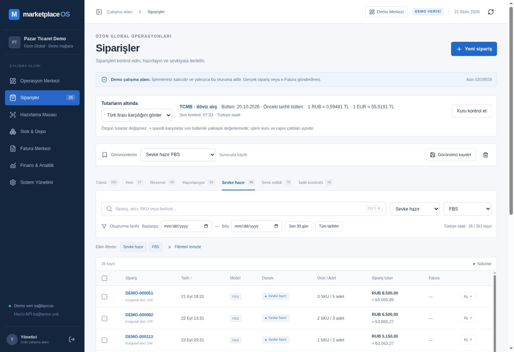

# FX-01 — Canlı gösterim kontrolü

21 Ekim 2026. Kod `edb55b6923ab0e3422b23409dc87c2b975967920`, Vercel `dpl_8aw9269rQRKM5E1Vi8zTVCDt6kcv`: production READY; commit/alias eşleşmesi doğrulandı.

Adres: https://marketplace-os-amber.vercel.app/workspace?section=orders

Mevcut yönetici demo session'ında TCMB bülteni 20.10.2026, 1 RUB = 0,59481 TL ve 1 EUR = 55,5191 TL olarak ekrana geldi. Önceki tarihli bülten ibaresi görünür. Varsayılan TL karşılığı gözlendi: DEMO-000051, RUB 8.500,00 altında ≈ ₺5.055,89. Euro seçilince özgün RUB 8.500,00 değişmeden altında ≈ €91,07 oldu. Yalnız özgün tutar seçilince ikinci tutar kaldırıldı; TL seçimine geri dönülünce ≈ ₺5.055,89 geri geldi.

Sipariş/stock/finans/ayar yazma komutu gönderilmedi. Seçim yalnız geçici ekran state'idir. Kayıtlı görünüm önceki teslimden korundu. Bu kontrol kur alma ve seçimin dar kanıtıdır; tüm modüller, hata enjeksiyonu, oturumsuz endpoint ve Excel/PDF regresyonu canlıda denenmiş sayılmaz. Kodda read-only kur kaynağı dışında gerçek Ozon/Paraşüt bağlantısı yoktur. Yan menüdeki genel “Harici API bağlantısı yok” metni de bunu net söyleyecek biçimde düzeltilir.

