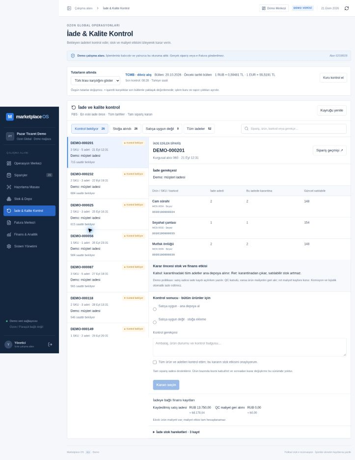

# INV-02 — Canlı salt okuma / form kontrolü

21 Ekim 2026. Kod commit `545b690a68952b8af8bbec5345dd380edc51b9b9`, Vercel `dpl_Cxx9GcSCwtJUvVxrXLJZpERPj8c1`: production READY, commit ve production alias eşleşmesi kontrol edildi.

Adres: https://marketplace-os-amber.vercel.app/workspace?section=returns

Mevcut yönetici demo oturumunda ayrı menü açıldı. Arama boşken 26 bekleyen / 26 stoğa alınan / 0 satışa uygun olmayan / 52 toplam FBS iade gözlendi. DEMO-000201 seçili iadede üç SKU / beş adet; iadeye ait karantina 2/1/2 ve güncel satılabilir stok 148/154/148 ayrı gösterildi. Finans bölümünde kayıtlı REFUND, QC maliyet geri alımı ve eksik maliyet uyarısı görüldü.

8690100000034 barkoduyla arama sayıları 3 bekleyen / 2 stoğa alınan / 5 toplam olarak daraldı. Karar seçilmemişken düğme kapalıydı. Satışa uygun seçimi ve geçerli gerekçe girilince checkbox olmadan yine kapalı; checkbox sonrası düğme açık oldu. Düğmeye basılmadı. Stoğa alınan kuyruğunda DEMO-000177 tamamlanmış karar, sıfır net karantina, dokuz stok hareketi ve karar tarihi görüldü; karar radio sayısı 0. Başlangıca dönülüp arama temizlendi, form denemesi kaydedilmeden bırakıldı.

QC / RETURN / başka komut, reset, rol veya stok/finans mutasyonu yapılmadı. Bu kontrol UI gating ve read-side verinin dar kanıtıdır; kabul/ret işlemi yeni ekrandan uçtan uca tamamlandı, depo/muhasebe gerçek oturumda denendi veya iki operatör senaryosu geçti demek değildir. Bunlar TEST_HANDOFF.md listesinde açık. Tam sayfa screenshot çağrısı zaman aşımına uğradı; ardından görünen ekran API'siyle kanıt alındı.

