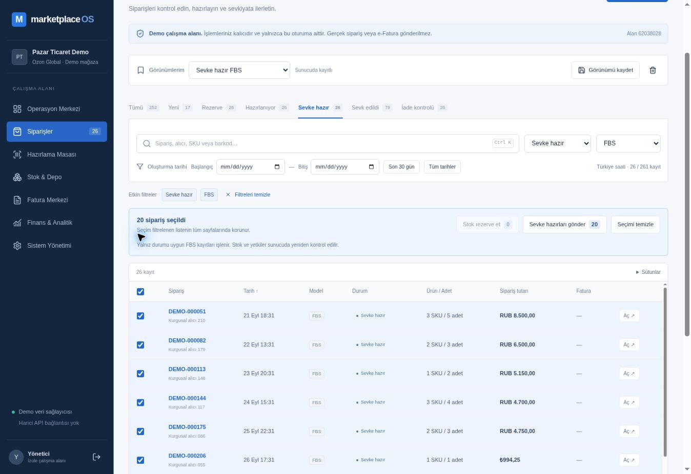

# OPS-02 — canlı kontrol kaydı

21 Ekim 2026, Europe/Istanbul. Kod commit: `1b5c1aaae0a44d541e7dcd81fbf588138310a245`.
Vercel production deployment `dpl_CZfmrEgi53syq4afzpr7Pe2dnX4Z`: READY; commit ve production alias eşleşmesi kontrol edildi.

Adres: https://marketplace-os-amber.vercel.app/workspace?section=orders

## Gözlenen sonuç

Mevcut yönetici demo oturumunda FBS / Sevke hazır filtreleri ve Tarih artan sıralaması seçildi. “Sevke hazır FBS” kişisel görünümü sunucuya kaydedildi. Tam sayfa yenilemeden sonra görünüm seçimi, iki filtre, Tarih artan sıralaması ve “Sunucuda kayıtlı” bildirimi korundu; 261 kayıt içinden 26 sonuç gösterildi.

Sayfadaki 20 sipariş seçildi. Toplu çubuk 20 seçim, rezervasyon adayı 0 (devre dışı) ve sevkiyat adayı 20 gösterdi. Sevkiyat düğmesine basılmadı. Bu gözlem aday sayımını doğrular; toplu sevkiyatın uçtan uca geçtiği iddia edilmez.

Bu kontrolde yalnız kişisel görünüm kaydı yazıldı. Sipariş oluşturma, rezervasyon, sevkiyat, stok hareketi, demo sıfırlama veya rol değiştirme yapılmadı. Ekran yalnız kurgusal demo kayıtları içerir.

## Açık kabul kapsamı

Sütun gizleme / sayfa boyutunun tarayıcıda geri yüklenmesi, görünüm güncelleme-silme, farklı kullanıcıların tarayıcı oturumları ve hata sonrası toplu işlem deneyimi kullanıcı / Codex E2E devir listesinde kalır. Sunucu izolasyonu ve eşzamanlılık ayrı PostgreSQL hedefli testlerinde doğrulandı. Bu kısa kontrol tam regresyon veya kullanıcı kabulü değildir. FX-01 bu teslimin kapsamında değildir.

