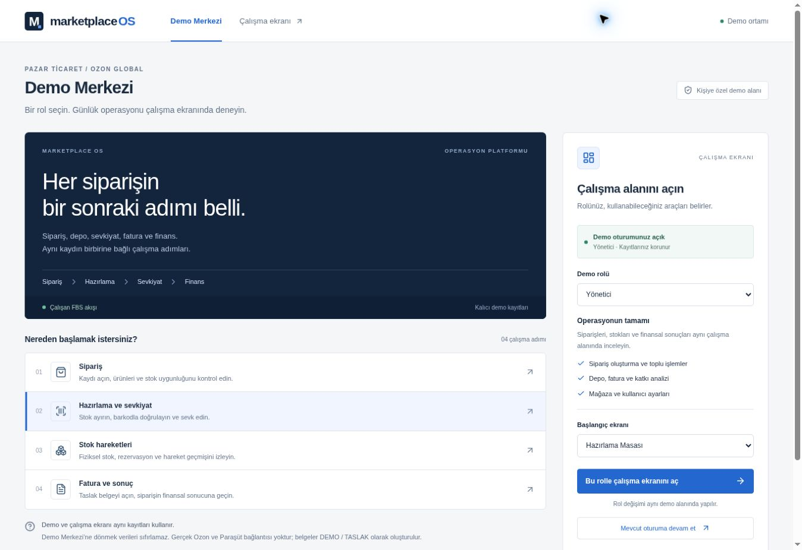

# UI-01 — Canlı kısa kontrol

21 Ekim 2026. Kod commit'i: `a11f6076f7cab808e566de786e1328b37116c1df`. Vercel production deployment: `dpl_4DKPDGk7yFQh5mw4R7XZqgm4n3JR`, **READY**; ana alias `marketplace-os-amber.vercel.app`.

## Gözlemlenen

1. Ana adreste Demo Merkezi açıldı; ayrı rol/başlangıç formu, iş adımları ve mevcut yönetici oturumuna devam bağlantısı göründü.
2. Mevcut oturuma devam bağlantısı `/workspace?section=dashboard` çalışma ekranını açtı; gerçek demo snapshot'ı, menü ve kayıtlar göründü.
3. Hazırlama Masası menüsüne geçildi; çalışma üst çubuğundaki Demo Merkezi bağlantısı `/?returnTo=packing` oldu.
4. Merkeze dönüşte başlangıç seçimi Hazırlama Masası olarak geldi; devam bağlantısı `/workspace?section=packing` gösterdi.

Bu read-only gezinmede yeni sipariş, barkod, sevkiyat, reset veya rol mutasyonu yapılmadı. Mevcut demo oturumu kullanıldı. Kayıtların tümü için DB mutabakatı, yeni oturum açma/rol değiştirme, logout, iki masaüstü boyutu, mobil ve tam E2E bu kısa kontrolün kapsamı değildir. Kullanıcının kabulü hâlâ bekleniyor.

Ekran görüntüsü viewport kaydıdır; tam sayfa veya farklı cihaz doğrulaması olarak yorumlanmaz. Görsel, yalnız kurgusal demo ve genel rol bilgisi içerir.
